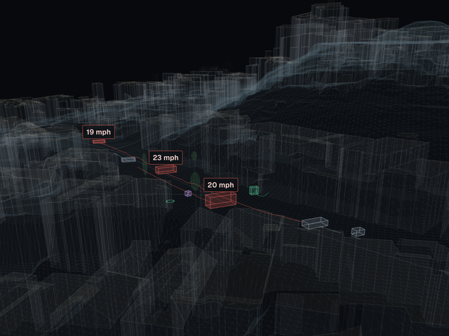
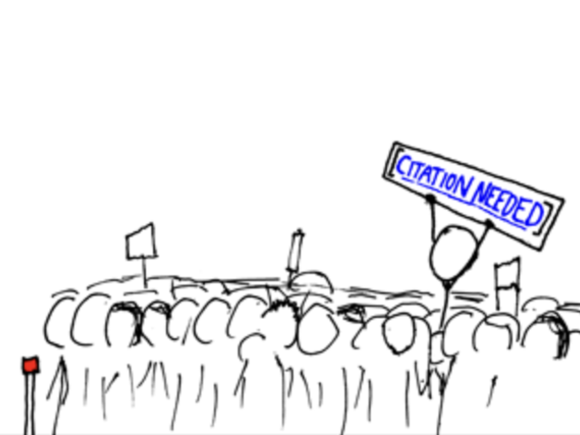
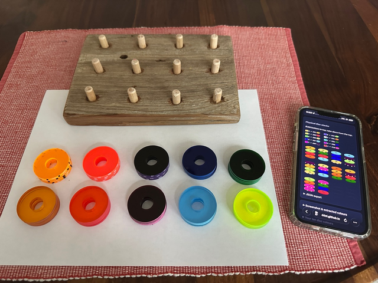
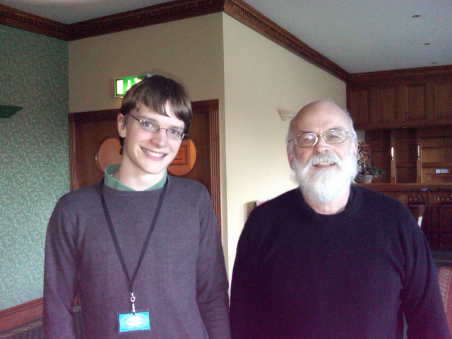
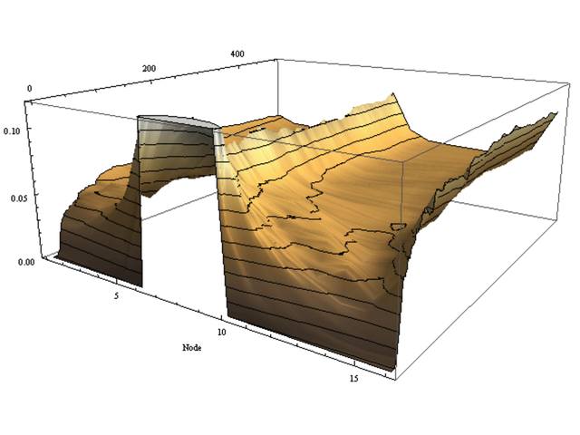
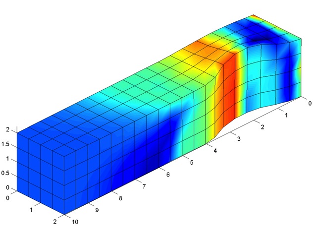

## Hi, I'm David 🐬
 　
 　
 　

* 🏡 Irish engineer living in San Francisco, husband and father
* 🚸 Building [`velocity.report`](https://github.com/banshee-data/velocity.report), citizen radar to empower street safety advocacy
* ☎️ Airbnb decade club: built telephony infrastructure, internal tools, reporting & canary analysis pipelines
* 🚀 Co-founder of [PhoneSys](https://www.ycombinator.com/companies/phonesys), part of Y Combinator’s Summer 2011 batch

<table role="presentation">
  <tr>
    <td width="50%" valign="top">
      <h3><a href="https://velocity.report">velocity.report</a></h3>
      

      
Open-source radar and LiDAR platform for measuring street speeds. Advocate for safer streets with irrefutable data.

    </td>
    <td width="50%" valign="top">
      <h3>Gerardus</h3>
      

      
A high-definition mapping service, vector geometry from aerial and roadside LiDAR.

    </td>
  </tr>
  <tr>
    <td width="50%" valign="top">
      <h3><a href="https://github.com/ddol/citation-needed">citation-needed</a></h3>
      

      
An academic citation assistant that indexes a corpus of papers so you can search the text and verify quotes against their sources.

    </td>
    <td width="50%" valign="top">
      <h3><a href="https://ddol.github.io/colour-puzzle-mapper/">Colour Puzzle Mapper</a></h3>
      

      
A companion for the daily Color Puzzle, built to help play the game offline.

      
<a href="https://ddol.github.io/colour-puzzle-mapper/">Open the mapper</a> · <a href="https://www.reddit.com/r/ColorPuzzleGame/">r/ColorPuzzleGame on Reddit</a>

    </td>
  </tr>
  <tr>
    <td width="50%" valign="top">
      <h3>The internet audio network</h3>
      

      
A technology podcast and FM radio show featuring interviews, including a conversation with Terry Pratchett.

      
<a href="https://web.archive.org/web/20120423234156/http://ian.ie/521/terry-pratchett/">Terry Pratchett interview (archived)</a>

    </td>
    <td width="50%" valign="top">
      <h3>The Skynet Game</h3>
      

      
A puzzlehunt from Skynet.

      
<a href="https://tyrion.users.skynet.ie/game/2009/language/">2009 language round</a>

    </td>
  </tr>
  <tr>
    <td width="50%" valign="top">
      <h3>Fairness in Qutrit Walks</h3>
      

      
My MSc thesis explored how adding a third, stay-put state changes the behaviour of a quantum walk. I also built a tool for computing walks on lines and cycles.

      
<a href="https://tyrion.users.skynet.ie/msc/david-dolphin_msc-thesis.pdf">MSc thesis (PDF)</a>

    </td>
    <td width="50%" valign="top">
      <h3>WarpViz for WARP3D</h3>
      

      
For my undergraduate engineering project, I built a MATLAB visualiser for the WARP3D finite-element solver and compared its modelling workflow with Abaqus.

      
<a href="https://tyrion.users.skynet.ie/fyp/cd/david-dolphin_fyp-report.pdf">Final-year report (PDF)</a>

    </td>
  </tr>
</table>

## Boardgames 🎲

I love playing board games with my family, some of our favourites include:

You can find a full list of games we play on [Board Game Geek.com (BGG)](https://boardgamegeek.com/collection/user/ddol?sort=rating&sortdir=desc&rankobjecttype=subtype&rankobjectid=1&columns=title%7Cstatus%7Cversion%7Crating%7Cbggrating%7Cplays%7Ccomment%7Ccommands&geekranks=Board%20Game%20Rank&own=1&objecttype=thing&ff=1&subtype=boardgame)
